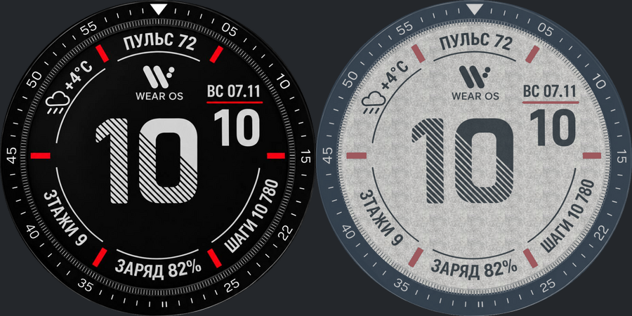

# Циферблат Wear OS 1

Проект точного переноса эскиза на Samsung Galaxy Watch4 Classic 46 мм (450×450).

## Текущий результат

- Тёмная тема извлечена непосредственно из `references/29937.jpg`: буквы, цифры, положения элементов и штриховка не перерисовываются и не заменяются шрифтом.
- Область 920×920 с началом (139, 140) равномерно уменьшается до 450×450. Общий коэффициент — 450/920; независимого масштабирования текста нет.
- Светлая тема использует те же исходные пиксельные маски надписей, цифр и штриховки. Меняется только окраска; подложка собрана из реального фрагмента второго фото, `references/29886.jpg`, область 110×70 с началом (550, 655).
- Внешнее «22» оставлено как в исходнике.

Текстура светлой темы основана на исходном фото, но повторяется плиткой. Это не точное восстановление всей поверхности: перспектива, освещение и JPEG уже присутствуют в фотографии. Для совпадения без повторов нужен исходный файл текстуры или плоский оригинал циферблата. Результат не следует объявлять идентичным текстуре оригинального дисплея.

## Статус реализации

Это проект графических ресурсов, не готовый APK. Все значения на изображениях статические, как в эскизе. Установка на часы, динамические время/дата/датчики, настройки и AOD ещё не реализованы. Единое изображение нельзя выдавать за работающий циферблат.

Для рабочего циферблата потребуется выделение статических элементов и восстановление полного набора цифр: фото содержит только «10», и по нему нельзя точно получить все отсутствующие глифы. При реализации сохранять координаты и единый масштаб; не подменять гарнитуру приблизительной.

## Файлы

- `design/dark-450.png`, `design/light-450.png` — нативное разрешение часов.
- `design/*-920.png` — мастер-ресурсы с круглой прозрачной маской.
- `design/texture-sample.png` — образец текстуры из второго фото.
- `references/` — неизменённые пользовательские изображения.
- `scripts/render.sh` — воспроизводимая обработка через ImageMagick 7.
- `docs/geometry.json` — параметры переноса.

Повторная сборка графики: `bash scripts/render.sh`.

## Автоматизация GitHub

На каждом обновлении `main` GitHub Actions проверяет пиксельное совпадение тёмного мастер-ресурса с исходным фрагментом, разрешение и прозрачность двух тем. Затем сохраняет графические ресурсы как скачиваемый артефакт `watchface-artwork-450`. Это проверка и упаковка графики; сборки APK пока нет.
