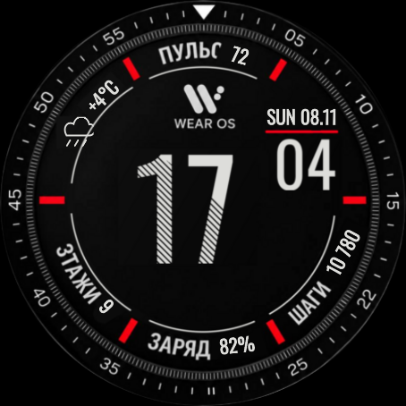
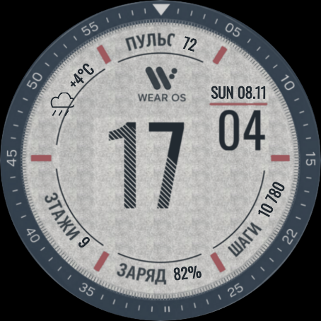
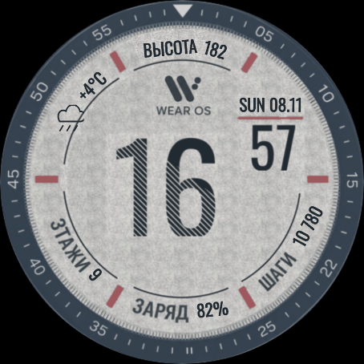
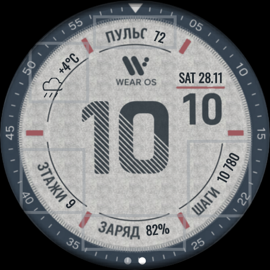
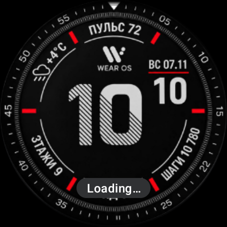

# Проверка исправлений 1.1 — до установки

Рабочая ветка: `fix/editor-and-data`. Релиз 1.0.0 не заменён.

- Добавлен обязательный флаг `Editable=true`: штатный редактор показывает тему и пять полей данных.
- Поля поддерживают SHORT_TEXT, LONG_TEXT, RANGED_VALUE и EMPTY. Шаги и батарея имеют системные источники; остальные источники выбираются на часах.
- Подпись сектора берётся из TITLE выбранного источника. Для стандартного показателя сохраняется исходная надпись. Если источник не передаёт TITLE, определить название автоматически невозможно.
- Погода принимает температуру как из TEXT, так и из TITLE с суффиксом °/°C/°F. При отсутствии данных выводится прочерк.
- Дуги восстановлены отдельным слоем, маски замены подписей не затрагивают их радиус.
- Масштаб координат одинаков для всех тем: 920 единиц → 450 пикселей на Watch4 Classic 46 мм. Изображение 10:10 сохранено из эскиза; остальные цифры реконструированы и не гарантируют точное совпадение с неизвестным исходным шрифтом.
- Светлая фактура получена из участка второго фото. Фотография под углом и освещением не позволяет восстановить всю исходную подложку пиксельно.

## Проверка в эмуляторе

Workflow `emulator.yml` автоматически собирает и устанавливает отладочный APK в Wear OS 4 или 5, подключает отдельное приложение тестовых источников, проверяет переход минуты, открывает штатный редактор, переключает тему и проверяет изменение подписи. Тестовые источники не входят в устанавливаемый пользователю релиз.

Значения 72, +4°C, 9, 82% и 10 780 в снимках — тестовые данные Android ComplicationDataSourceService. Они проверяют отображение данных, но не получение показателей Samsung Health. Наличие отдельных источников пульса, погоды и этажей на физической Watch4 ещё нужно подтвердить.

## Подтверждённый результат

[Полный тест Wear OS 5 / Android API 34 — успешно](https://github.com/maksontanya-stack/ciferblat-wear-os-1/actions/runs/42502042879): минуты обновляются, светлая тема сохраняется после редактора, температура остаётся температурой при перестановке TEXT/TITLE, «ПУЛЬС 72» меняется на «ВЫСОТА 182», доступны пять полей и штатный выбор источников. В журнале подтверждена доставка TEXT «ТЕСТ ГОРОД» и TITLE «ВЫСОТА».

[Сборка и Android Lint — успешно](https://github.com/maksontanya-stack/ciferblat-wear-os-1/actions/runs/42501671817). Официальный WFF validator и Memory Footprint Evaluator: PASS.

[Полный тест Wear OS 4 / Android API 33 — успешно](https://github.com/maksontanya-stack/ciferblat-wear-os-1/actions/runs/42502658376). Проверки те же: переход минуты, сохранение светлой темы, получение температуры из TITLE, замена подписи и штатный выбор источников. Тест ожидает фактическую асинхронную доставку данных. Физическая Watch4 Classic не подключена к этой среде.

| Тёмная — активный циферблат | Светлая — после закрытия редактора |
|---|---|
|  |  |

Смена подписи вместе с числом:

Пять настраиваемых полей и стандартный выбор источника:

Это реальные снимки эмулятора Wear OS 4 454×454, без дорисовки. Размеры элементов масштабируются равномерно до 450×450 на целевых часах. Новая версия не опубликована для установки: сначала пользователь оценивает внешний вид.

## Быстрые исправления по замечаниям

После снимков выше: значок погоды повёрнут на −45°, смещён наружу от дуги и уменьшен с 72 до 64 единиц; «3ТАЖИ» исправлено на «ЭТАЖИ», «22» на «20» в обеих темах. Маска значения пульса сужена, чтобы сохранить букву «С». Снимки выше относятся к предыдущему варианту.
