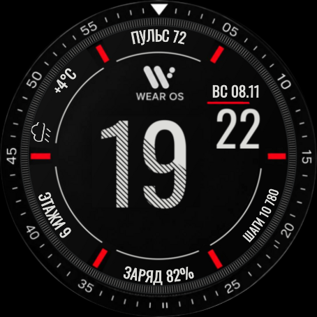
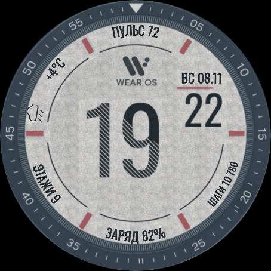
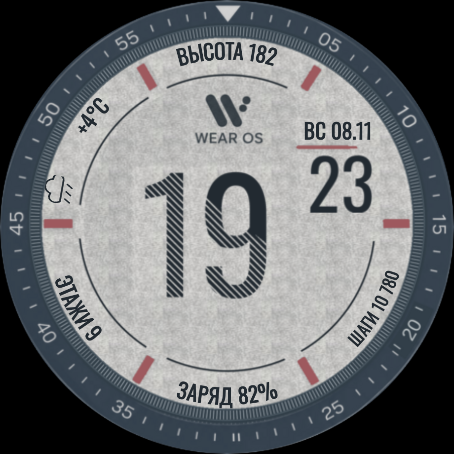
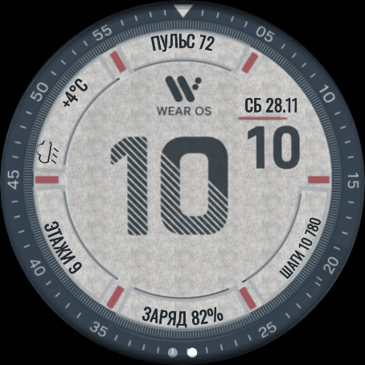

# Радиальные поля 1.2 — предпросмотр

- Все подписи и значения пяти полей выводятся шрифтом, а не изображениями на подложке.
- Выбор источника меняет значение и передаваемый им заголовок. Типовые названия приводятся к короткой форме; перечень — `design/metric-captions.json`.
- Примеры: «Максимальная высота над уровнем моря» → «ВЫСОТА», «Количество пройденных шагов» → «ШАГИ», «Уровень заряда аккумулятора» → «ЗАРЯД», «Атмосферное давление» → «ДАВЛЕНИЕ».
- Для неизвестного названия сохраняется его текст. Если строка длинная, шрифт автоматически уменьшается без многоточия. Сокращается название, а не значение показателя.
- Пять штатных областей выбора — кольцевые секторы BoundingArc. Они ограничены соседними красными рисками, с небольшим отступом от самих рисок; кольцевая область имеет радиусы 303–376 в исходной сетке 920×920.
- Размер шрифта выбирается автоматически; центр, радиус и угловые границы дуги остаются фиксированными.
- Если источник не передаёт TITLE, остаётся только его значение: WFF не предоставляет название провайдера вместо отсутствующего TITLE. Старая подпись из картинки не подставляется.
- У часов добавлен прозрачный запас снизу: размер и положение цифр сохранены, нижние штрихи больше не упираются в край. Проверены все 48 изображений; верхние 126 строк каждого совпадают с версией 1.1.0 пиксельно.

День недели всегда выводится на русском (ПН–ВС), дата — дд.мм, независимо от языка системы.

Мелкое кольцо рисок построено заново: 360 одинаковых штрихов с шагом 1°. Очистка старых подписей не затрагивает кольцо. Отметка «20» выровнена по радиусу оригинальной «40», её соседние риски восстановлены с зазором.

## Реальные снимки

[Полный тест Wear OS 5 — PASS](https://github.com/maksontanya-stack/ciferblat-wear-os-1/actions/runs/42514258910): пять видимых полей, сохранение темы, обновление минут, приём данных, короткая подпись «ВЫСОТА» для длинного названия и автоматическое уменьшение неизвестного длинного текста. Повторный полный прогон тоже успешен. На Wear OS 4 проверены время и пять видимых полей, но переключение темы в штатном редакторе пока завершается с ошибкой. Совместимость новой версии с Wear OS 4 не подтверждена; до установки требуется уточнить прошивку целевых часов. Значения на снимках — тестовые, получены от отдельных Android ComplicationDataSourceService, не от физических датчиков Samsung.

| Тёмная | Светлая |
|---|---|
|  |  |

«Максимальная высота над уровнем моря» отображается как «ВЫСОТА»:

Кольцевые области штатного редактора:

[Пример уменьшения неизвестного длинного названия](screenshots/radial-1.2/active-light-fitted-title.png). Название нового нестандартного источника при необходимости можно добавить в перечень смысловых сокращений.

Версия 1.1.0 не заменена; новый релиз для установки пока не опубликован.
